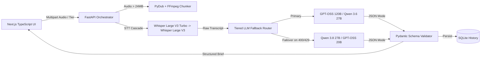

# Pulse AI — Resilient Audio Intelligence & Structured Summarization Pipeline

**Live App:** [Pulse AI Studio on Vercel](https://pulse-ai-summarizer-hvl4ien3v-aishwaryaeshita01-cmyk.vercel.app/)  
**API Docs (Swagger):** [FastAPI Swagger UI on Render](https://onrender.com)

An enterprise-grade, full-stack Generative AI platform that transcribes long-form audio and generates strictly validated, structured executive intelligence briefs. Built with **FastAPI**, **Next.js (TypeScript)**, **Groq Cloud LPU Inference**, **Pydantic**, and **Docker**.

---

## System Architecture



---

## Key Engineering Highlights

* **Zero-Downtime Model Fallback Routing:** Decouples business logic from hardcoded model IDs using a tiered routing registry. Automatically fails over on upstream deprecations (`400 model_decommissioned`), rate limits (`429`), or schema violations.
* **Strict Pydantic JSON Schema Enforcement:** Forces deterministic structured outputs (`executive_summary`, `key_takeaways`, `action_items`, `sentiment`) using Groq JSON mode paired with runtime Pydantic validation.
* **Automated Long-Audio Chunking:** Detects recordings exceeding 24MB (up to 100MB) and splits them into 10-minute MP3 segments via `pydub` and `ffmpeg` before stitching transcripts seamlessly.
* **Persistent Brief Archive & Export:** Stores processed intelligence reports in SQLite with instant reload, deletion, and one-click Markdown (`.md`) report generation.
* **Automated Regression Testing:** Includes a mocked `pytest` suite verifying failover behavior during simulated model decommissioning and malformed LLM outputs.

---

## Quick Start (Local Development)

### 1. Backend Setup (FastAPI)
```bash
python3 -m venv venv
source venv/bin/activate
pip install -r requirements.txt
cp .env.example .env  # Add your GROQ_API_KEY
uvicorn main:app --reload --port 8000
```

### 2. Frontend Setup (Next.js)
```bash
cd frontend
npm install
npm run dev
```
Open **`http://localhost:3000`** in your browser.

---

## Containerized Deployment (Docker Compose)

Run the entire stack (including `ffmpeg` for audio chunking) with a single command:
```bash
docker compose up --build
```
